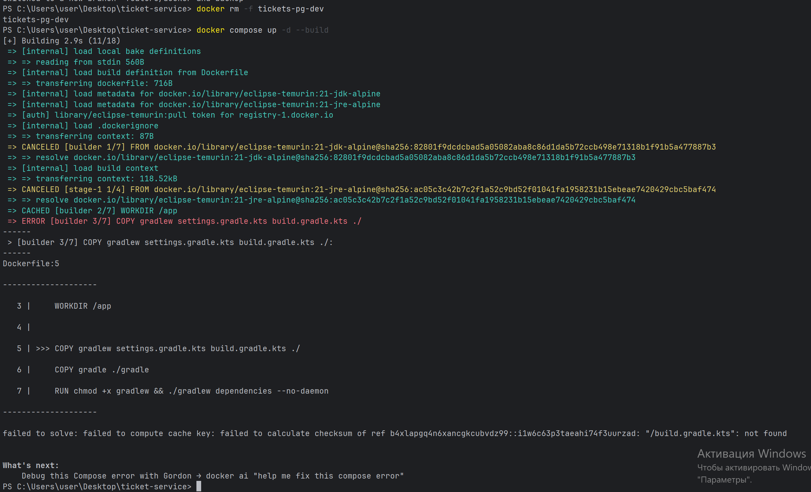
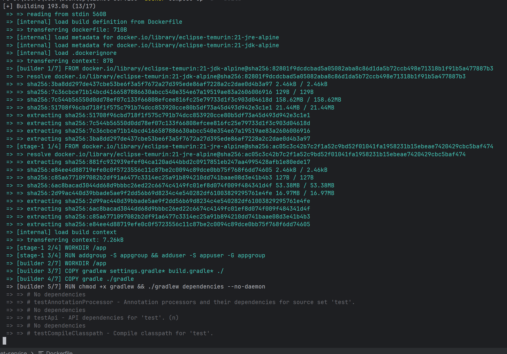
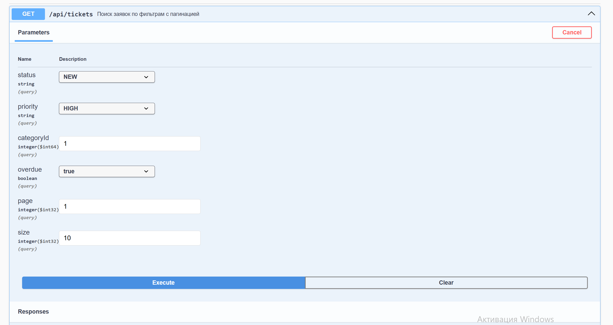
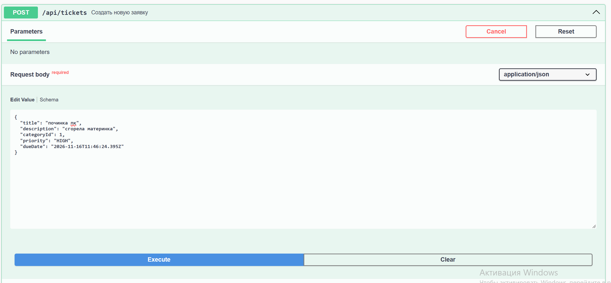
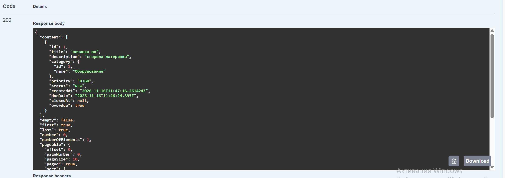
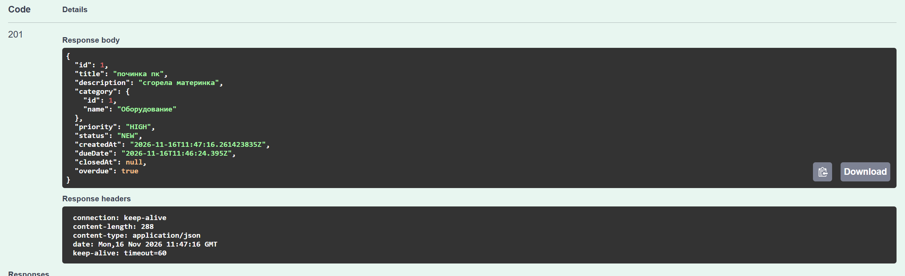
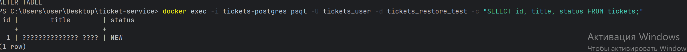
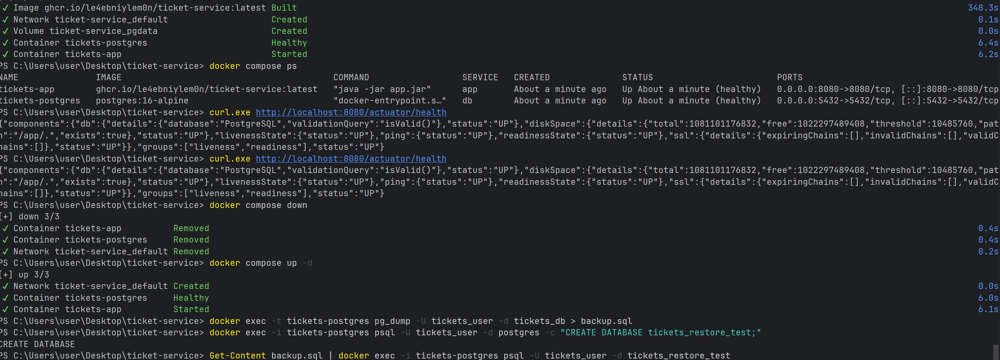

# Инструкция по запуску и резервному копированию (Docker)

## 1. Подготовка и запуск контейнеров
1. Создайте файл переменных окружения `.env` на основе шаблона:
   ```powershell
   copy .env.example .env
   ```
2. Соберите образ приложения и запустите контейнеры в фоновом режиме:
   ```powershell
   docker compose up -d --build
   ```
3. Проверьте статус контейнеров (оба должны перейти в состояние `healthy`):
   ```powershell
   docker compose ps
   ```
4. Проверьте работу сервиса через эндпоинт здоровья:
   ```powershell
   curl.exe http://localhost:8080/actuator/health
   ```
   Ожидаемый ответ: `{"status":"UP",...}`.

## 2. Просмотр логов и остановка
* Просмотр логов приложения:
  ```powershell
  docker compose logs -f app
  ```
* Просмотр логов базы данных:
  ```powershell
  docker compose logs -f db
  ```
* Остановка и удаление контейнеров (данные сохраняются в томе `pgdata`):
  ```powershell
  docker compose down
  ```

## 3. Проверка сохранности данных после перезапуска
1. Создайте тестовую заявку через Swagger UI (`http://localhost:8080/swagger-ui.html`) или API.
2. Перезапустите контейнеры:
   ```powershell
   docker compose down
   docker compose up -d
   ```
3. Запросите список заявок `GET /api/tickets` — созданная ранее запись остаётся в базе данных.

## 4. Резервное копирование и восстановление PostgreSQL
1. **Создание резервной копии (дампа) рабочей базы:**
   ```powershell
   docker exec -t tickets-postgres pg_dump -U tickets_user -d tickets_db | Out-File -Encoding UTF8 backup.sql
   ```
2. **Создание отдельной тестовой базы данных для проверки:**
   ```powershell
   docker exec -i tickets-postgres psql -U tickets_user -d postgres -c "CREATE DATABASE tickets_restore_test;"
   ```
3. **Восстановление данных из копии в тестовую базу:**
   ```powershell
   Get-Content -Encoding UTF8 backup.sql | docker exec -i tickets-postgres psql -U tickets_user -d tickets_restore_test
   ```
4. **Проверка восстановленных таблиц и записей:**
   ```powershell
   docker exec -i tickets-postgres psql -U tickets_user -d tickets_restore_test -c "SELECT id, title, status FROM tickets;"
   ```

## Результаты моих проверок:







