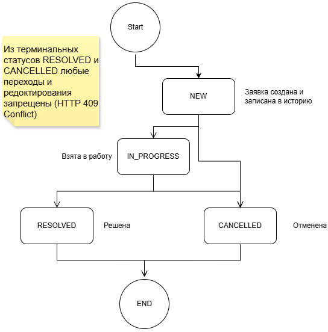
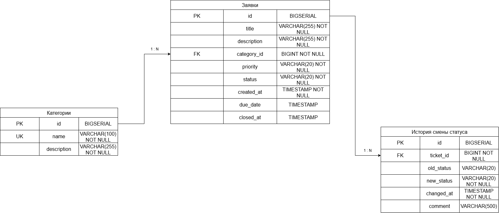

# Спецификация требований: Сервис обработки заявок (Ticket Service)

## 1. Описание проблемы, пользователей и границ проекта

### 1.1. Проблема
В организации заявки на техническую поддержку поступают через разные каналы (электронная почта, мессенджеры, устные обращения). Из-за отсутствия централизованной системы учёта обращения теряются, сроки их выполнения не контролируются, история смены статусов не сохраняется, а сводные отчёты по работе службы поддержки формируются вручную.

### 1.2. Пользователи системы (роли)
Система реализуется в виде серверного REST API без модуля авторизации, поэтому выделяются три логические роли потребителей API:
* **Инициатор заявки (Сотрудник)** — регистрирует новые обращения, просматривает их детали и историю изменений.
* **Специалист технической поддержки** — просматривает очередь обращений с фильтрацией по статусам и просрочкам, редактирует параметры заявок и переводит их по этапам выполнения.
* **Руководитель службы поддержки** — запрашивает сводную аналитику за выбранный период для контроля нагрузки и соблюдения сроков.

### 1.3. Границы проекта (Scope)
* **Входит в объём разработки:**
    * REST API для создания, просмотра, редактирования, фильтрации заявок, работы со справочником категорий и историей статусов (Java + Spring Boot);
    * модуль формирования сводной статистики за период (Kotlin/JVM);
    * реляционное хранение данных и версионирование схемы БД (PostgreSQL + Flyway);
    * документация API (OpenAPI / Swagger UI) и коллекция HTTP-запросов (Postman);
    * автоматизированное тестирование (модульные, интеграционные с Testcontainers и сквозные тесты);
    * контейнеризация (многоэтапный Dockerfile, Docker Compose) и настройка CI/CD (GitHub Actions).
* **Не входит в объём разработки:**
    * графический пользовательский интерфейс (Web UI / фронтенд);
    * система регистрации, аутентификации и ролевого доступа;
    * интеграция с почтовыми серверами или мессенджерами;
    * микросервисная архитектура и оркестрация в Kubernetes.
## 2. Пользовательские истории (User Stories) и критерии приёмки

### US-1. Регистрация новой заявки
**История:** Как инициатор заявки, я хочу создать новое обращение с указанием заголовка, описания, категории, приоритета и планового срока выполнения, чтобы проблема была зафиксирована в системе.
* **Критерии приёмки:**
    1. При отправке валидного запроса `POST /api/tickets` система создаёт заявку со статусом `NEW`, фиксирует время создания (`createdAt`), добавляет первую запись в историю статусов (`null` → `NEW`) и возвращает код **HTTP 201** с телом созданной заявки.
    2. Если не передан или пуст заголовок (`title`), отсутствует `categoryId` или не указан приоритет, система возвращает **HTTP 400**, а запись в БД не создаётся.
    3. Если передано значение приоритета, отличное от `LOW`, `MEDIUM`, `HIGH`, возвращается **HTTP 400**.
    4. Если указан несуществующий `categoryId`, возвращается **HTTP 404**.

### US-2. Просмотр заявки по идентификатору
**История:** Как пользователь системы, я хочу получить детальную информацию о конкретной заявке по её идентификатору, чтобы узнать её текущий статус, срок и признак просрочки.
* **Критерии приёмки:**
    1. При запросе `GET /api/tickets/{id}` для существующей заявки возвращается код **HTTP 200** и данные заявки, включая вычисляемый признак просрочки `overdue` (`true`, если срок `dueDate` истёк, а статус равен `NEW` или `IN_PROGRESS`).
    2. При запросе по несуществующему `id` возвращается единый формат ошибки со статусом **HTTP 404**.

### US-3. Редактирование параметров активной заявки
**История:** Как специалист поддержки, я хочу изменить описание, приоритет или срок выполнения заявки, если уточнились детали обращения.
* **Критерии приёмки:**
    1. При отправке валидного запроса `PATCH /api/tickets/{id}` для заявки в статусе `NEW` или `IN_PROGRESS` обновляются переданные поля (`description`, `priority`, `dueDate`) и возвращается код **HTTP 200**.
    2. При попытке отредактировать заявку в финальном статусе `RESOLVED` или `CANCELLED` API возвращает **HTTP 409**, а данные заявки в БД остаются неизменными.
    3. При попытке отредактировать несуществующую заявку возвращается **HTTP 404**.

### US-4. Изменение статуса заявки по правилам жизненного цикла
**История:** Как специалист поддержки, я хочу переводить заявку между статусами (`NEW` → `IN_PROGRESS` → `RESOLVED` или отменять её), чтобы отражать ход работы над обращением.
* **Критерии приёмки:**
    1. Разрешённые переходы (`NEW` → `IN_PROGRESS`, `IN_PROGRESS` → `RESOLVED`, `NEW` → `CANCELLED`, `IN_PROGRESS` → `CANCELLED`) выполняются успешно и возвращают **HTTP 200**.
    2. При переводе заявки в статус `RESOLVED` система автоматически записывает время закрытия (`closedAt`).
    3. Изменение статуса заявки и сохранение записи в историю статусов выполняются атомарно в рамках одной транзакции БД.
    4. При попытке выполнить запрещённый переход (например, перевести закрытую заявку `RESOLVED` в работу `IN_PROGRESS`, повторно открыть `CANCELLED` или перевести `NEW` сразу в `RESOLVED`) API возвращает **HTTP 409**, при этом статус и история заявки остаются неизменными.

### US-5. Просмотр истории изменения статусов
**История:** Как специалист поддержки или руководитель, я хочу просмотреть хронологию изменения статусов конкретной заявки, чтобы отследить этапы её обработки.
* **Критерии приёмки:**
    1. При запросе `GET /api/tickets/{id}/history` для существующей заявки возвращается **HTTP 200** и список всех переходов в хронологическом порядке (предыдущий статус, новый статус, время изменения, комментарий).
    2. Для несуществующего идентификатора заявки возвращается **HTTP 404**.

### US-6. Поиск и фильтрация списка заявок с пагинацией
**История:** Как специалист поддержки, я хочу искать заявки по статусу, приоритету, категории и признаку просрочки с постраничным выводом, чтобы быстро находить нужные обращения в очереди.
* **Критерии приёмки:**
    1. При запросе `GET /api/tickets` с параметрами пагинации (`page`, `size`) и фильтрами (`status`, `priority`, `categoryId`, `overdue`) система возвращает **HTTP 200** и страницу записей, удовлетворяющих всем заданным условиям.
    2. Если подходящих заявок нет, возвращается **HTTP 200** с пустым списком (`content: []`, `totalElements: 0`).

### US-7. Получение справочника категорий
**История:** Как инициатор заявки, я хочу просмотреть список доступных категорий обращений, чтобы выбрать подходящую при регистрации заявки.
* **Критерии приёмки:**
    1. Запрос `GET /api/categories` возвращает **HTTP 200** и список категорий, предварительно загруженных в БД миграциями.

### US-8. Получение сводной статистики работы поддержки
**История:** Как руководитель службы поддержки, я хочу получить сводную статистику по заявкам за выбранный период `[from, to)`, чтобы оценить количество обращений, распределение по статусам и приоритетам, число просрочек и среднее время решения.
* **Критерии приёмки:**
    1. Запрос `GET /api/reports/summary?from=...&to=...` возвращает **HTTP 200** и сводный отчёт по заявкам, созданным в интервале `[from, to)`.
    2. Если в выборке за период отсутствуют завершённые заявки со статусом `RESOLVED`, поле среднего времени решения (`averageResolutionSeconds`) возвращается как `null`.
    3. Если параметр `from` больше или равен `to`, либо не указаны обязательные границы периода, API возвращает **HTTP 400**.
## 3. Функциональные и нефункциональные требования

### 3.1. Функциональные требования (ФТ)

* **ФТ-1. Структура сущности «Заявка»:**
  Система должна хранить для каждой заявки следующие поля: уникальный идентификатор (`id`), заголовок (`title` — обязательное поле), подробное описание (`description`), ссылка на категорию (`categoryId` — обязательное поле), приоритет (`priority`), текущий статус (`status`), дата и время создания (`createdAt`), плановый срок выполнения (`dueDate`) и дата и время закрытия (`closedAt`).

* **ФТ-2. Допустимые значения приоритетов и статусов:**
    * Приоритет заявки может принимать только значения: `LOW`, `MEDIUM`, `HIGH`.
    * Статус заявки может принимать только значения: `NEW`, `IN_PROGRESS`, `RESOLVED`, `CANCELLED`.
    * При создании новой заявки ей автоматически присваивается начальный статус `NEW`.

* **ФТ-3. Правила переходов между статусами (Жизненный цикл):**
    * Из статуса `NEW` разрешён переход только в `IN_PROGRESS` или `CANCELLED`.
    * Из статуса `IN_PROGRESS` разрешён переход только в `RESOLVED` или `CANCELLED`.
    * Статусы `RESOLVED` и `CANCELLED` являются конечными: повторное открытие, изменение статуса или редактирование полей (`description`, `priority`, `dueDate`) таких заявок запрещены.

* **ФТ-4. Транзакционность истории изменений:**
  Любое изменение статуса заявки (включая присвоение начального статуса при создании) и добавление соответствующей записи в историю статусов должны выполняться атомарно в рамках одной транзакции базы данных.

* **ФТ-5. Определение просроченной заявки:**
  Заявка считается просроченной (`overdue = true`), если для неё задан срок выполнения (`dueDate != null`), текущее системное время строго больше `dueDate`, а текущий статус заявки равен `NEW` или `IN_PROGRESS`. Закрытые (`RESOLVED`) и отменённые (`CANCELLED`) заявки просроченными не считаются.

* **ФТ-6. Фильтрация, пагинация и справочник категорий:**
    * Система должна предоставлять список категорий из предзаполненного справочника в БД.
    * Система должна поддерживать постраничный вывод списка заявок с возможностью одновременной фильтрации по статусу, приоритету, категории и признаку просрочки.

* **ФТ-7. Коды ответов HTTP:**
    * Успешное создание ресурса — `201 Created`, успешное чтение или обновление — `200 OK`.
    * Ошибки валидации входных данных или некорректные параметры запроса — `400 Bad Request`.
    * Обращение к несуществующей заявке или категории — `404 Not Found`.
    * Попытка выполнить запрещённый переход статуса или отредактировать закрытую/отменённую заявку — `409 Conflict`.

* **ФТ-8. Модуль сводной статистики (Kotlin):**
    * Эндпоинт `GET /api/reports/summary` реализуется с использованием Kotlin/JVM (`data class`, nullable-типы, операции над коллекциями) и принимает интервал `[from, to)`.
    * По выборке заявок, созданных в полуинтервале `[from, to)`, рассчитываются: общее количество заявок, распределение по текущим статусам, распределение по приоритетам, количество открытых просроченных заявок и среднее время решения завершённых (`RESOLVED`) заявок (разница между `closedAt` и `createdAt`). При отсутствии завершённых заявок среднее время возвращается как `null`.

---

### 3.2. Нефункциональные требования (НФТ)

* **НФТ-1. Воспроизводимый запуск:**
  Развёртывание приложения и базы данных PostgreSQL должно выполняться единообразно в любой среде с установленным Docker с помощью единой конфигурации `compose.yaml` и многоэтапного `Dockerfile`.

* **НФТ-2. Сохранность данных после перезапуска:**
  Данные PostgreSQL должны сохраняться в постоянном томе (Docker volume) и не теряться при остановке, перезапуске или пересоздании контейнеров приложения и СУБД.

* **НФТ-3. Единый формат ошибок:**
  Все ошибочные ответы API (`400`, `404`, `409`, `500`) должны возвращаться клиенту в едином структурированном JSON-формате с указанием метки времени (`timestamp`), HTTP-кода (`status`), типа ошибки (`error`), понятного сообщения (`message`) и пути запроса (`path`).

* **НФТ-4. Отсутствие секретов в репозитории:**
  Учётные данные базы данных, пароли и токены доступа не должны храниться в исходном коде или в открытом виде в Git-репозитории. Конфигурация передаётся через переменные окружения (шаблон `.env.example` в репозитории, секреты CI/CD в настройках платформы).

* **НФТ-5. Детерминированность и независимость от времени:**
  Бизнес-логика проверки сроков и расчёта статистики должна получать текущее время через абстракцию `java.time.Clock`, что гарантирует независимость результатов автотестов от даты и времени их запуска.

* **НФТ-6. Автоматизация миграций и совместимость:**
  Создание и обновление структуры таблиц БД выполняется автоматически при старте приложения с помощью инструмента миграций (Flyway). Миграции должны сохранять обратную совместимость в рамках практики для возможности безопасного отката версии приложения.
## 4. Диаграммы проектирования

### 4.1. Диаграмма процесса обработки заявки


### 4.2. ER-диаграмма базы данных

## 5. Перечень методов REST API 

### 5.1. Сводная таблица эндпоинтов

| Метод | URL | Назначение | Коды ответа |
| :--- | :--- | :--- | :--- |
| `GET` | `/api/categories` | Получить список категорий | `200` |
| `POST` | `/api/tickets` | Создать новую заявку | `201`, `400`, `404` |
| `GET` | `/api/tickets/{id}` | Получить заявку по ID | `200`, `404` |
| `PATCH` | `/api/tickets/{id}` | Редактировать описание, приоритет и срок | `200`, `400`, `404`, `409` |
| `PATCH` | `/api/tickets/{id}/status` | Изменить статус заявки | `200`, `400`, `404`, `409` |
| `GET` | `/api/tickets/{id}/history` | Получить историю изменения статусов | `200`, `404` |
| `GET` | `/api/tickets` | Поиск заявок с фильтрацией и пагинацией | `200`, `400` |
| `GET` | `/api/reports/summary` | Сводная статистика за период (модуль Kotlin) | `200`, `400` |

---

### 5.2. Примеры запросов и ответов

#### 1. Получение справочника категорий — `GET /api/categories`
**Ответ (`200 OK`):**
```json
[
  {
    "id": 1,
    "name": "Оборудование",
    "description": "Проблемы с ПК, принтерами и периферией"
  },
  {
    "id": 2,
    "name": "Программное обеспечение",
    "description": "Установка, обновление и ошибки ПО"
  }
]
```

#### 2. Создание заявки — `POST /api/tickets`
**Запрос:**
```json
{
  "title": "Не печатает сетевой принтер в каб. 304",
  "description": "При отправке документа на печать выдаёт ошибку соединения",
  "categoryId": 1,
  "priority": "HIGH",
  "dueDate": "2026-11-20T18:00:00Z"
}
```
**Ответ (`201 Created`):**
```json
{
  "id": 1,
  "title": "Не печатает сетевой принтер в каб. 304",
  "description": "При отправке документа на печать выдаёт ошибку соединения",
  "category": {
    "id": 1,
    "name": "Оборудование"
  },
  "priority": "HIGH",
  "status": "NEW",
  "createdAt": "2026-11-16T10:30:00Z",
  "dueDate": "2026-11-20T18:00:00Z",
  "closedAt": null,
  "overdue": false
}
```

#### 3. Редактирование параметров заявки — `PATCH /api/tickets/{id}`
**Запрос:**
```json
{
  "description": "Уточнение: принтер HP LaserJet в каб. 304, мигает красный индикатор",
  "priority": "MEDIUM",
  "dueDate": "2026-11-21T18:00:00Z"
}
```
**Ответ (`200 OK`):** возвращает обновлённый объект заявки (аналогично структуре из п. 2).

#### 4. Изменение статуса заявки — `PATCH /api/tickets/{id}/status`
**Запрос:**
```json
{
  "status": "IN_PROGRESS",
  "comment": "Принял заявку в работу, проверяю подключение"
}
```
**Ответ (`200 OK`):** возвращает заявку с обновлённым полем `"status": "IN_PROGRESS"`.

#### 5. История смены статусов — `GET /api/tickets/{id}/history`
**Ответ (`200 OK`):**
```json
[
  {
    "id": 1,
    "oldStatus": null,
    "newStatus": "NEW",
    "changedAt": "2026-11-16T10:30:00Z",
    "comment": "Заявка создана"
  },
  {
    "id": 2,
    "oldStatus": "NEW",
    "newStatus": "IN_PROGRESS",
    "changedAt": "2026-11-16T10:45:00Z",
    "comment": "Принял заявку в работу, проверяю подключение"
  }
]
```

#### 6. Поиск с фильтрацией и пагинацией — `GET /api/tickets?status=IN_PROGRESS&priority=HIGH&categoryId=1&overdue=false&page=0&size=10`
**Ответ (`200 OK`):**
```json
{
  "content": [
    {
      "id": 1,
      "title": "Не печатает сетевой принтер в каб. 304",
      "categoryName": "Оборудование",
      "priority": "HIGH",
      "status": "IN_PROGRESS",
      "createdAt": "2026-11-16T10:30:00Z",
      "dueDate": "2026-11-20T18:00:00Z",
      "overdue": false
    }
  ],
  "page": 0,
  "size": 10,
  "totalElements": 1,
  "totalPages": 1
}
```

#### 7. Сводная статистика (модуль Kotlin) — `GET /api/reports/summary?from=2026-11-01T00:00:00Z&to=2026-12-01T00:00:00Z`
**Ответ (`200 OK`):**
```json
{
  "from": "2026-11-01T00:00:00Z",
  "to": "2026-12-01T00:00:00Z",
  "totalCreated": 12,
  "byStatus": {
    "NEW": 3,
    "IN_PROGRESS": 4,
    "RESOLVED": 4,
    "CANCELLED": 1
  },
  "byPriority": {
    "LOW": 2,
    "MEDIUM": 7,
    "HIGH": 3
  },
  "overdueOpenCount": 2,
  "averageResolutionSeconds": 5400.5
}
```

#### 8. Единый формат ответа при ошибке (НФТ-3)
**Пример ответа (`409 Conflict` при попытке изменить закрытую заявку):**
```json
{
  "timestamp": "2026-11-16T11:00:00Z",
  "status": 409,
  "error": "Conflict",
  "message": "Недопустимый переход статуса из RESOLVED в IN_PROGRESS",
  "path": "/api/tickets/1/status"
}
```
## 6. Backlog проекта

Общий объём работ рассчитан на **72 академических часа** по плану практики.

| № | Задача | Приоритет | Оценка (ч) |
| :-: | :--- | :---: | :---: |
| 1 | Анализ задачи, составление пользовательских историй, требований и диаграмм (ER и статусы) | Высокий | 6 |
| 2 | Настройка репозитория Git, сборка проекта на Gradle (Java + Kotlin), проектирование БД и миграций Flyway | Высокий | 6 |
| 3 | Разработка основного API на Java: создание, просмотр и редактирование заявок, справочник категорий | Высокий | 10 |
| 4 | Реализация смены статусов, транзакционной истории изменений, фильтрации списка и обработки ошибок (`400`, `404`, `409`) | Высокий | 8 |
| 5 | Реализация модуля статистики за период на Kotlin (`GET /api/reports/summary`) и связывание его с Java-слоем | Высокий | 10 |
| 6 | Написание модульных и интеграционных тестов (JUnit, Mockito/MockK, Testcontainers с PostgreSQL) и проверка покрытия | Высокий | 10 |
| 7 | Составление тест-плана, фиксация найденного дефекта и добавление регрессионного теста | Средний | 2 |
| 8 | Упаковка в Docker (Dockerfile, Docker Compose), настройка health check, логов и резервного копирования БД | Высокий | 8 |
| 9 | Настройка автоматической сборки и деплоя через CI/CD (GitHub Actions), проверка отката на предыдущую версию | Высокий | 8 |
| 10 | Оформление коллекции запросов для проверки API, инструкции (README) и отчёта к защите | Средний | 4 |
| | **Итого** | | **72** |
