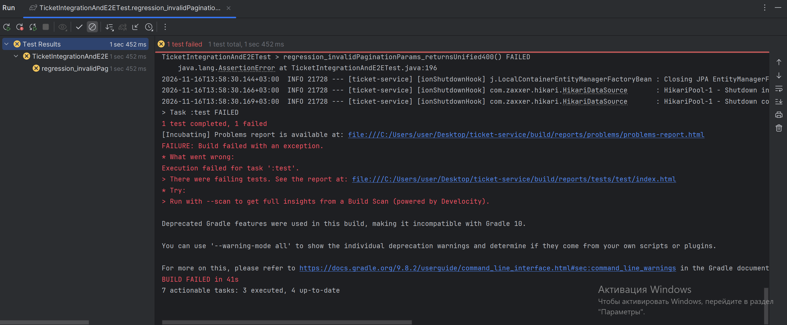
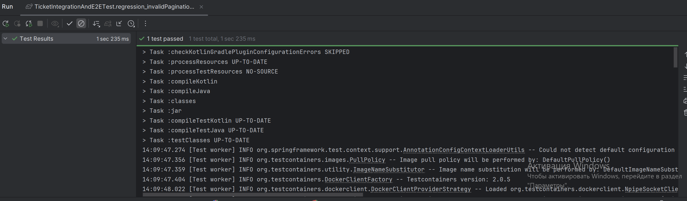
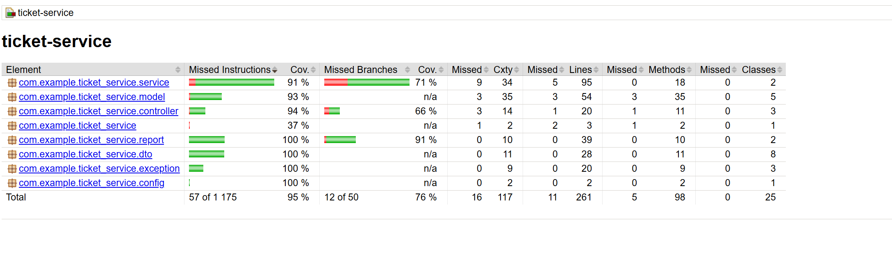

# Тест-план: Сервис обработки заявок (Ticket Service)

## 1. Объект и цели тестирования
Цель тестирования — подтвердить соответствие сервиса функциональным и нефункциональным требованиям спецификации: корректность жизненного цикла заявок, транзакционность истории статусов, расчёт просрочки, работу фильтров и точность расчёта статистики в модуле на Kotlin.

## 2. Виды и уровни тестирования
1. **Модульное тестирование (Unit Tests):**
    * Проверка бизнес-логики `TicketService` (Java) с использованием JUnit 5, Mockito и фиксированного времени `Clock.fixed(...)`.
    * Проверка расчёта отчёта `TicketReportService` (Kotlin) с использованием JUnit 5 и MockK (включая пустые выборки и отсутствие завершённых заявок).
    * Тестирование Java-компонента (`TicketService`) из Kotlin-теста.
2. **Интеграционное тестирование (Integration Tests):**
    * Проверка работы репозиториев, миграций Flyway, транзакционности и REST-контроллеров на реальной СУБД PostgreSQL 16 (Testcontainers).
3. **Сквозное тестирование (E2E Scenarios):**
    * Сценарий 1: Полный жизненный цикл заявки (`создание` → `взятие в работу` → `закрытие` → `проверка истории и попадания в статистику`).
    * Сценарий 2: Попытка изменить статус закрытой заявки (`HTTP 409`) с проверкой неизменности состояния и истории в БД.

## 3. Критерии приёмки тестирования
* Все модульные, интеграционные и сквозные тесты проходят успешно (`./gradlew test`).
* Сформирован отчёт о покрытии кода JaCoCo (`build/reports/jacoco/test/html/index.html`).
* Найденный в ходе проверки дефект зафиксирован, исправлен и закрыт регрессионным тестом.

## 4. Журнал дефектов (Регрессия)

* **DEF-01:** При передаче слишком большого размера страницы (`size > 100`) в `GET /api/tickets` сервис не ограничивал выборку и возвращал `200 OK` вместо `400 Bad Request`.
    * **Исправление:** Добавлена проверка границ пагинации (`page >= 0`, `1 <= size <= 100`) в `TicketController`.
    * **Регрессионный тест:** `TicketIntegrationAndE2ETest.regression_invalidPaginationParams_returnsUnified400`.

### Подтверждение исправления (До / После)

**1. Обнаружение ошибки (тест падает, возвращается 200 вместо 400):**

**2. После исправления в TicketController (регрессионный тест пройден):**

**3. Результат покрытия тестов JaCoCo:**
